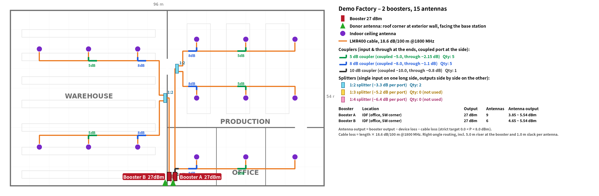
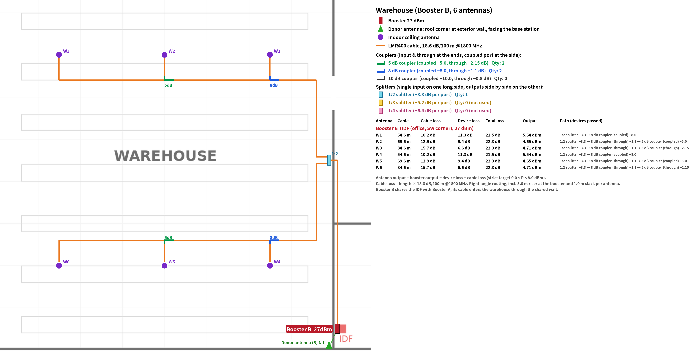

# Indoor Coverage Design Skill

An agent skill (Claude, Codex, and other coding agents) for designing **indoor cellular
signal-booster coverage plans** from a floor plan:

areas → ceiling antennas → booster / IDF placement → coupler & splitter cabling → per-antenna link budget →
drawings + bill of materials, in **English and Chinese**.

[中文说明](README.zh-CN.md)

| Overview | Area drawing |
|---|---|
|  |  |

## Supplement (2026-11-24)

The [dated supplement in SKILL.md](SKILL.md#补充规则2026-11-24) adds the owner's five requirements while retaining applicable existing guidance: establish coverage area before layout; space antennas evenly using coverage needs; fix booster locations and routing/components before power selection; use actual regional models and required bands; and use this owner's 5D/LMR400 project conventions with frequency-specific loss data. Added cable to attenuate one excessive branch requires confirmation. See [regional equipment](references/regional-equipment.md). This update also syncs the previously reviewed local multi-floor, panel-antenna and strict-output checks.

## What it does

- **Step-by-step workflow** with confirmation at design decisions that need user input (`SKILL.md`).
- **Design rules** learned from real projects (`references/design-rules.md`): IDF-first booster placement,
  one cable per booster, splitter vs coupler choice, split only where cables diverge, no duplicated
  runs, aligned couplers, 0–8 dBm antenna window, and more.
- **Calculator / renderer** (`scripts/coverage.py`):
  - right-angle cable length, cable loss and device loss → output of every antenna;
  - brute-force optimiser for 5 / 8 / 10 dB coupler values;
  - design-rule lint (duplicated runs, misaligned couplers, wrong splitter sides, IDF rule, limits);
  - colour-coded drawings (coupler colour by dB, splitter colour by ratio, booster colour by power)
    with legend quantities;
  - bill of materials (boosters by power, couplers, splitters, antennas, cable indoor/donor/order
    quantity in m and ft, connectors) and per-antenna CSV, all in `en/` and `zh/`.
- **Editable equipment config** (`config/equipment.yaml`, regional profiles in `config/regions/`):
  cable loss (single value or per band), booster powers / real model table, coupler and splitter losses,
  antenna output window, colours, fonts.
- **Multi-floor** plans with real vertical runs, **wall-mounted panel antennas**, **per-band** checks and
  model/band validation (`examples/demo-hotel/`).
- **Regression tests** with golden numbers: `python tests/run_tests.py`.

## Install

### Claude (Claude Code / Claude apps)
Copy or clone this folder into your skills directory, e.g.
```bash
git clone https://github.com/qagkeee163-wq/indoor-coverage-design-skill ~/.claude/skills/indoor-coverage-design
pip install -r ~/.claude/skills/indoor-coverage-design/requirements.txt
```
In the Claude apps you can also upload the folder as a zip under Settings → Capabilities → Skills.

### Codex
Install as a Codex skill:
```bash
git clone https://github.com/qagkeee163-wq/indoor-coverage-design-skill ~/.codex/skills/indoor-coverage-design
pip install -r ~/.codex/skills/indoor-coverage-design/requirements.txt
```
then restart Codex (or ask Codex: `$skill-installer install https://github.com/qagkeee163-wq/indoor-coverage-design-skill`).
Alternatively open the cloned repository with Codex; `AGENTS.md` tells Codex to follow `SKILL.md`.

### Other agents
Point the agent at `SKILL.md`. Everything else is plain Python 3.9+ (`Pillow`, `PyYAML`).

## Use

Tell the agent something like: *"Here is the floor plan of a 26,000 m² factory, base station ~1 km north,
priority areas circled in red. Design the coverage."* The agent will work through the steps and ask you
to confirm each one.

Run the tool directly:
```bash
python scripts/coverage.py areas    examples/demo-factory/design.json
python scripts/coverage.py layout   examples/demo-factory/design.json
python scripts/coverage.py optimize examples/demo-factory/design.json
python scripts/coverage.py check    examples/demo-factory/design.json --lang en
python scripts/coverage.py report   examples/demo-factory/design.json
```

## Repository layout
```
SKILL.md                     workflow (entry point for agents)
AGENTS.md                    entry point for Codex
config/equipment.yaml        equipment & limits
references/design-rules.md   design rules (EN/中文)
references/design-file-format.md
scripts/coverage.py          CLI
scripts/covtool/             engine, lint, render, bom, i18n, build helpers
examples/demo-factory/       fictional example with outputs
docs/github-upload.zh-CN.md  how to publish this repo (Chinese)
```

## Limitations
- Coordinates are entered as pixels on the floor-plan image; the agent reads the plan, you confirm.
- Losses are planning estimates (no connector loss, no wall attenuation model). Verify on site.
- Booster gain / model selection (step 3) needs site RSRP and your model list.

## License
MIT
